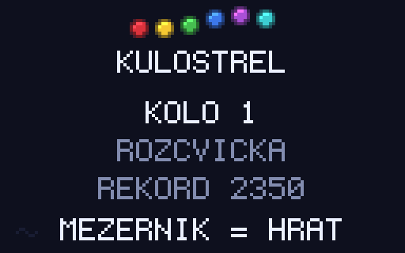
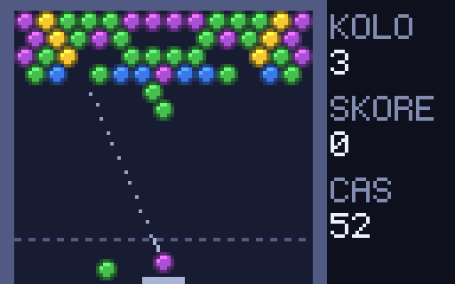
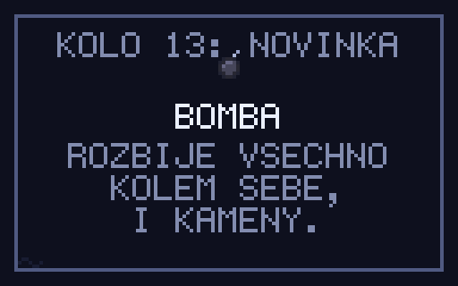
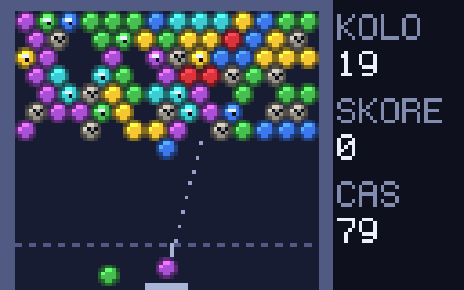
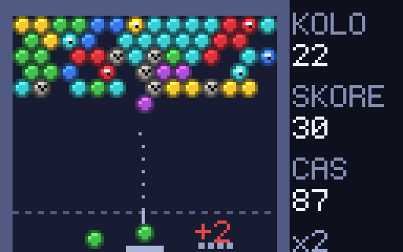

# Kulostřel

Logická střílečka kuliček v enginu [BLIT386](https://blit386.dev). Hraje se v prohlížeči i v terminálu.

Zamiř odpalovačem a vystřel kuličku do shluku, který visí ze stropu. Tři a více kuliček stejné barvy prasknou; kuličky,
které tím ztratí spojení se stropem, spadnou. Kuličky se celou dobu pomalu posouvají dolů, v každém kole o něco
rychleji. Rozložení kuliček se při každé hře generuje znovu. Vyčisti plochu a kolo je tvoje; když kulička překročí čáru
nad odpalovačem, hra končí.

## Obrázky

|  |  |
| --- | --- |
|  |  |
| Menu: výběr kola a rekord | Míření: pomocná čára ukazuje i odraz od stěny |
|  |  |
| Karta s novinkou (13. kolo, bomba) | Kameleoni (s okem) a kameny v 19. kole |
|  |  |
| Od 21. kola přibývají řady shora (`+2` a tečky vpravo dole) |  |

Obrázky jsou vykreslené přímo z hry (128 × 80 pixelů, zvětšené 4×); v terminálu vypadá hra stejně.

## Kola

Kola nekončí, obtížnost roste pořád:

- **1–10:** přibývají barvy (3 → 6) a řady, kuličky klesají rychleji.
- **11–20:** speciální kuličky, vždy jedna nová, kterou před kolem představí karta:
  - **11 kameleon** (má oko): po každé ráně změní barvu,
  - **13 bomba** (tmavá s doutnákem): rozbije všechno kolem sebe, i kameny,
  - **15 duhová kulička** (mění barvy): pasuje ke každé barvě, které se dotkne,
  - **17 kámen** (šedý): nedá se rozbít, jen shodit nebo odpálit bombou.
- **21 a dál:** navíc shora přibývají řady. Vpravo dole v poli je vidět, kolik jich v kole ještě přibude (`+3`), a tečky
  ukazují, za kolik ran přijde další. Řad je v jednom kole nejvýš 6. Kola se střídají ve čtyřech typech (Tlak shora,
  Kamenolom, Kameleoni, Ohnostroj) a s každým kolem jsou o kousek těžší, až k pevným hranicím.

## Ovládání

| Akce | Klávesnice | Myš |
| --- | --- | --- |
| Mířit | šipky vlevo/vpravo nebo A/D (ťuknutí = malý krok, podržení = plynulé otáčení) | pohyb myší |
| Vystřelit | mezerník, šipka nahoru nebo W | levé tlačítko |
| Prohodit aktuální a další kuličku | šipka dolů nebo S | pravé tlačítko |
| Zpět do menu | Esc |  |

V menu se šipkami vybírá kolo. Dohrané kolo odemkne další. Když prohraješ, kola se znovu zamknou a začíná se od 1. kola.
Odemčená kola a rekord se ukládají v prohlížeči i v terminálu (blit-term je ukládá do
`~/.local/state/blit-term/storage/`).

## Skóre

Body se sčítají přes celou hru, od startu až do prohry.

- **10 bodů** za každou prasklou (i bombou odpálenou) kuličku, **20 bodů** za každou spadlou.
- **Kombo:** zásahy, které po sobě něco rozbijí, se násobí (×2, ×3 … až ×5). Rána, která nic nerozbije, kombo ukončí.
  Aktuální násobič je vpravo pod časem.
- **Časový bonus:** každé kolo má časový limit (vpravo „CAS“). Každá sekunda, která zbude při vyčištění kola, je za 10
  bodů. Po vypršení času se hraje dál, jen bez bonusu.

Ukládá se nejlepší skóre celé hry (rekord).

## Spuštění

Potřebuješ [Bun](https://bun.sh) 1.3+.

```bash
bun install
bun run dev    # v prohlížeči (adresu vypíše terminál)
bun run term   # v terminálu přes blit-term (Luquas95/Blit386_ASCI)
bun test       # testy herní logiky
```

### Hraní v terminálu

Obraz hry má 128 × 80 pixelů a jeden znak terminálu ukazuje 1 × 2 pixely. Pro ostrý obraz proto terminál potřebuje aspoň
**128 sloupců a 40 řádků** (41 se stavovým řádkem; zjistíš příkazem `stty size`, vypíše řádky a sloupce). Menší terminál
musí obraz zmenšit a ten se pak rozmaže: zvětši okno nebo zmenši písmo. Když je terminál aspoň dvakrát větší (256 × 80),
obraz se ostře zvětší.

Příkazy `bun run ...` spouštěj ve složce hry.

- `bun run term -- --status` přidá stavový řádek (fps, velikost); zabere jeden řádek navíc.
- `bun run term -- --scale nearest` zmenšuje bez rozmazání, ale vynechává pixely.
- Nejlépe se hraje v Kitty, WezTerm, Ghostty nebo foot (hlásí i uvolnění kláves).

## Struktura

- `src/game.js` - herní smyčka: vstup, stavy hry, vykreslování.
- `src/board.js` - mřížka kuliček (šestiúhelníkové rozložení, praskání skupin, padání kuliček, speciální kuličky,
  přidávání řad shora).
- `src/shot.js` - let kuličky, odrazy od stěn, pomocná čára míření.
- `src/levels.js` - nastavení obtížnosti pro libovolné kolo (`levelAt`) a generátor rozložení.
- `src/progress.js` - odemčená kola a rekord (localStorage).
- `src/scoring.js` - počítání bodů, komba a časového bonusu.
- `src/music.js` - znělky (začátek hry, dohrané kolo, každé desáté kolo, prohra).
- `src/config.js` - rozměry a laditelné hodnoty.

## Helpful commands

- `bun run dev` - start the game (the everyday command).
- `npx blit run` - the same thing, the friendly way.
- `npx blit play` - play-test the game from the terminal and print its state (`npx blit play --help` for the steps).
- `npx blit doctor` - check your setup if something seems off.
- `npx blit upgrade` - update BLIT386 to the latest version.
- `npx blit agents add <name>` - set up an AI assistant you did not pick at the start (`claude`, `cursor`,
  `antigravity`, `codex`, `copilot`, `gemini`, `opencode`, or `zed`); `npx blit agents sync` keeps its files current.
- `npx blit clean` - replace `src/game.js` with an empty skeleton when you want to start your own game from scratch.

The `blit` helper is installed inside this project, not on your whole computer, so it needs `npx` in front (it means
"run the helper that lives in this project"). Typing plain `blit` would say "command not found."

Everything here works the same on Windows (PowerShell or Command Prompt), macOS, and Linux. The `.gitattributes` file
keeps line endings consistent on every computer, so `format:check` agrees everywhere.

## Peek behind the scenes

While the game runs, you can open the engine overlay - a small panel showing frames per second and which renderer is
active.

- Keyboard: press the key just below Esc, in the very top-left corner of your keyboard. On US keyboards it is printed
  with `` ` `` and `~`. Classic PC games like Quake used that exact key to open their command console, and BLIT386 keeps
  the tradition. The engine listens for the key's position, not the symbol printed on it - on some keyboard layouts the
  `~` symbol sits somewhere else entirely, but the overlay key is still the one below Esc.
- No keyboard, or can't find the key? Click or tap the bottom-left corner of the game screen instead. That works
  everywhere: phones, tablets, the Steam Deck.

## Share your game

When you want to show your game to a friend:

```bash
bun run build
```

This packs everything into a `dist/` folder - a plain website, no server needed. Drag that folder onto a free static
host such as [Netlify Drop](https://app.netlify.com/drop) or [Cloudflare Pages](https://pages.cloudflare.com), and you
get a link anyone can open.

## When something breaks

It will - that is normal. Open `docs/when-something-breaks.md`. It explains how to read error messages and walks through
the usual suspects: blank screens, "command not found," forgotten `await`, and more.

## Learn more

- `AGENTS.md` - a short home base for you or an AI assistant.
- `docs/` - nine friendly guides: getting started, the game loop, drawing, input, colors, randomness and world
  generation, sound, hot reload, and fixing problems.
- [blit386.dev](https://blit386.dev) - the full BLIT386 documentation site. If you set up an AI assistant (Claude Code,
  Cursor, Antigravity, Codex, GitHub Copilot, Gemini CLI, OpenCode, or Zed), it can search this site directly - that is
  what its generated docs-server config is for (`.mcp.json` for Claude Code and GitHub Copilot, `.cursor/mcp.json` for
  Cursor, and so on). Claude Code's desktop app also reads `.claude/launch.json` here to start the game's preview server
  for you.
- [blit386.dev/llms.txt](https://blit386.dev/llms.txt) - the whole site's contents as one plain text file, handy for
  skimming or pasting into a chat.
